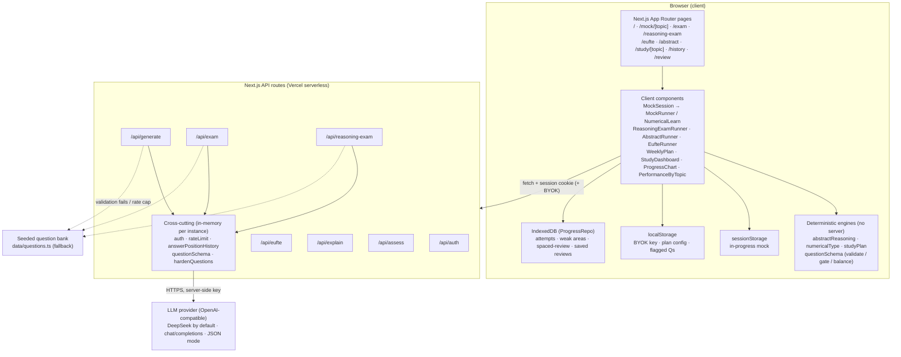
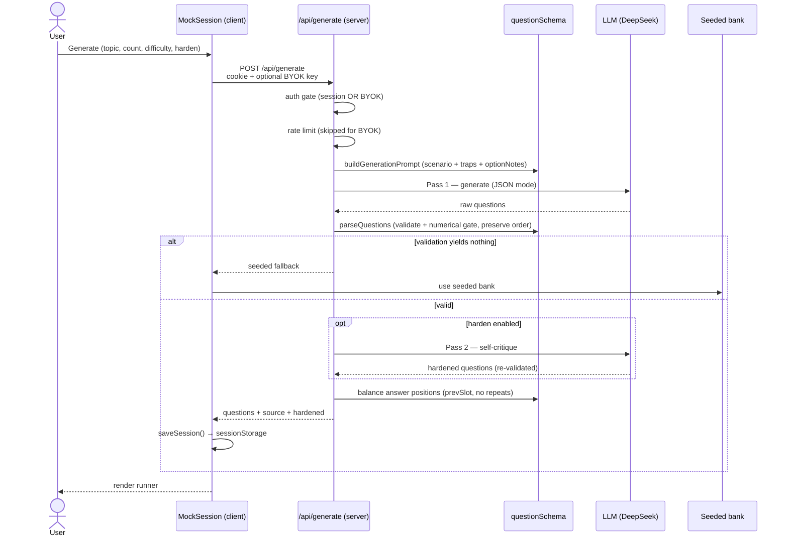

# EPSO AI Trainer — Architecture

System design for the EPSO/AD/430/26 (AD 8, Artificial Intelligence) trainer.
A single Next.js app on Vercel: a thin, stateless server (LLM proxy + guards)
with a fat client that handles grading, scoring, spaced repetition, study
planning, and all persistence.

> GitHub renders the Mermaid blocks below natively.

## High-level architecture



## Sequence — generate & harden questions



## Sequence — access-code auth (session cookie)

```mermaid
sequenceDiagram
  actor U as User
  participant Gate as AccessGate (client)
  participant API as /api/auth (server)
  participant Auth as auth.ts

  U->>Gate: enter access code
  Gate->>API: POST /api/auth { code }
  API->>Auth: verifyAccessCode (constant-time vs APP_ACCESS_CODE)
  alt valid
    Auth->>Auth: issueSessionCookie (HMAC-signed, httpOnly, 7d)
    API-->>Gate: 200 (Set-Cookie: epso_session)
  else invalid
    API-->>Gate: 401
  end
  Note over Gate,API: Later API calls send the cookie;<br/>hasValidSession() verifies the HMAC.<br/>BYOK key bypasses this gate entirely.
```

## Data stores

| Store | Location | Lifetime | Holds |
|---|---|---|---|
| sessionStorage | browser tab | until tab closes | in-progress mock (questions + answers) |
| localStorage | browser | persistent | BYOK key, plan config, flagged questions |
| IndexedDB (`ProgressRepo`) | browser | persistent | attempts, weak areas, spaced-review queue, saved test reviews |
| Signed cookie | browser ↔ server | 7 days | `epso_session` (HMAC, httpOnly) |
| In-memory (server) | serverless instance | until cold start | daily LLM cap, answer-position history |

There is **no server-side database** — all progress lives client-side behind the
`ProgressRepo` interface, designed so a hosted DB (Turso / Vercel PG) could be
swapped in for cross-device sync without changing dashboard logic.

## Key properties

- **Thin server, fat client** — API routes are stateless LLM proxies + guards; grading, scoring, spaced repetition, study planning, and abstract-reasoning generation run client-side or as pure functions.
- **LLM is untrusted** — every generated item passes `validateQuestion` + the numerical consistency gate; failures fall back to the seeded bank.
- **Two auth paths** — shared access code (server key, rate-capped) or BYOK (user's own key, uncapped, never stored or logged).
- **Deployment** — single Next.js app on Vercel. Env: `LLM_API_KEY`, `LLM_BASE_URL`, `LLM_MODEL`, `APP_ACCESS_CODE`, `SESSION_SECRET`, `LLM_DAILY_LIMIT`.
